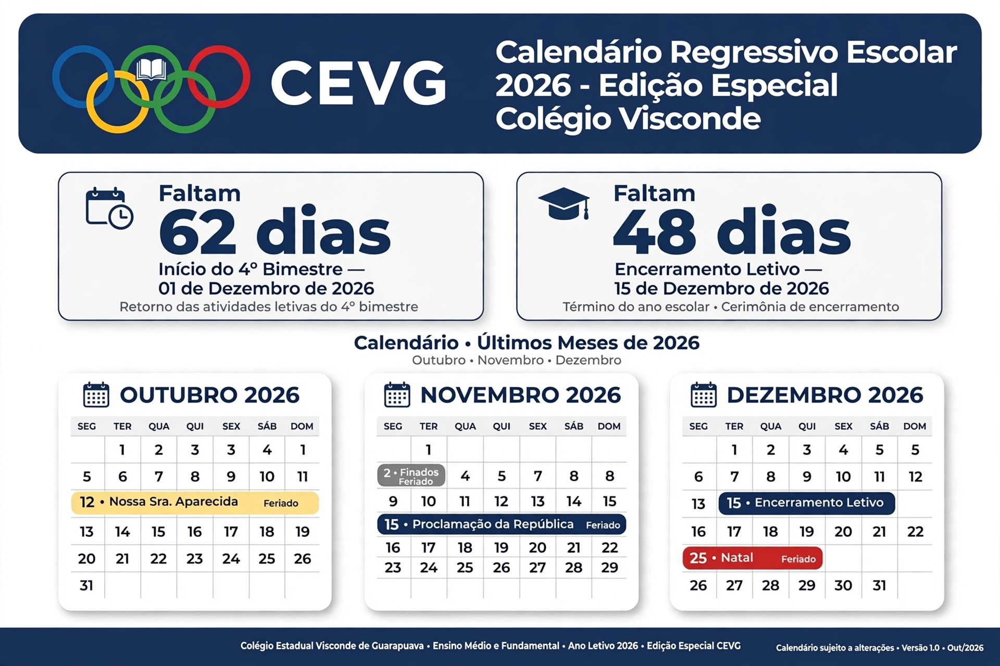

# 🎓 Calendário Regressivo Escolar 2026 — Edição Especial Colégio Estadual Visconde de Guarapuava

> Versão customizada e oficial para o CEVG — com identidade visual da escola, contagem inteligente de dias letivos e design refinado para uso em sala, secretaria e redes sociais.

[Edição Especial](https://img.shields.io/badge/Edição-Especial%20CEVG-1b365d?style=for-the-badge)
[Colégio Visconde](https://img.shields.io/badge/Colégio-Visconde%20de%20Guarapuava-blue?style=for-the-badge)
[GitHub Pages](https://img.shields.io/badge/GitHub%20Pages-Live-brightgreen?style=for-the-badge)
[HTML5](https://img.shields.io/badge/HTML5-E34F26?style=for-the-badge&logo=html5&logoColor=white)
[CSS3](https://img.shields.io/badge/CSS3-1572B6?style=for-the-badge&logo=css3&logoColor=white)
[License](https://img.shields.io/badge/License-MIT-blue?style=for-the-badge)

🔗 **Acesse ao vivo (original):** https://romeukaram.github.io/calendar-project/  
📚 **Esta edição:** `calendar-visconde` — fork com identidade CEVG

---

### 🏫 Sobre esta edição

Esta é a **Edição Especial Colégio Visconde**, criada a partir do projeto original [calendar-project](https://github.com/romeukaram/calendar-project) para ser usada oficialmente no **Colégio Estadual Visconde de Guarapuava — Guarapuava/PR**.

Mantém toda a lógica de contagem regressiva, mas adiciona a identidade visual da escola.

#### Identidade CEVG

- **Logo CEVG recriado em SVG vetorial** — sem dependência de imagem externa, nítido em 4K
- **4 anéis olímpicos:** Azul (C), Amarelo (E), Verde (V), Vermelho (G) — conforme logo oficial enviado
- **Livro aberto** ao centro dos anéis, simbolizando o caráter educacional
- **Header institucional:** com selo "Edição Especial" + badge "CEVG • 2026"
- **Mini-anéis** nos títulos dos meses e rodapé
- **Paleta preservada:** azul-marinho #1b365d + cores do logo como acentos

---

### ✨ O que faz

- **Duas contagens:**
  - Dias corridos até 18/12/2026 às 22:00
  - Dias letivos (congela em fins de semana e feriados)
- **Calendário Outubro-Dezembro 2026** com status por dia
- **Refinamentos de UI:**
  - Conteúdo alinhado no cantinho superior esquerdo (melhor leitura)
  - `holiday-name` com `line-clamp: 3` e `word-break` — não vaza mais "Nossa Senhora Aparecida"
  - Hover com `title` completo
  - Responsivo: 3 colunas > 2 colunas > 1 coluna

---

### 📸 Preview

Adicione no repositório um arquivo `preview-visconde.png` ou `preview.gif` e use:

```md

```

Sugestão de print: topo com header CEVG + contadores + calendário de novembro (com feriados).

---

### 📁 Como publicar como segundo projeto

Opção A — Novo repositório:
```bash
# 1. Crie no GitHub: calendar-visconde
git init
git add index.html README.md
git commit -m "feat: edição especial CEVG"
git branch -M main
git remote add origin https://github.com/romeukaram/calendar-visconde.git
git push -u origin main
# 2. Ative GitHub Pages em Settings > Pages > main / root
```

Opção B — Mesma repo, pasta `/visconde`:
```
calendar-project/
├── index.html (original)
├── visconde/
│   └── index.html (esta edição)
```

### 🗓️ Feriados 2026 incluídos

- 12/10 Nossa Senhora Aparecida
- 02/11 Finados
- 15/11 Proclamação da República
- 20/11 Consciência Negra

Edite facilmente no objeto `holidays`.

### 🛠️ Tecnologias

- HTML5 + CSS moderno (Grid, Flex, clamp, line-clamp)
- JavaScript puro — sem dependências
- SVG inline para logo (alta performance, sem requisição extra)
- Google Fonts Inter

### 👨‍🏫 Autor

**Prof. Romeu Karam** — Professor e desenvolvedor  
📍 Guarapuava - PR  
🔗 [Instagram @romeukaramneto](https://instagram.com/romeukaramneto) | [GitHub](https://github.com/romeukaram)

Feito com foco educacional para uso em sala de aula, secretaria e comunicação com famílias.

### 🤝 Uso pela escola

Esta edição pode ser:

- Incorporada no site oficial do colégio via `<iframe>`
- Projetada em TV da secretaria
- Compartilhada no grupo de pais/alunos
- Usada como base para calendário letivo 2027

> Se quiser, posso gerar uma versão com QR Code para impressão.

### 📄 Licença

MIT — livre para uso educacional pelo Colégio Estadual Visconde de Guarapuava e comunidade.

---

### 🔗 Projetos relacionados

- [Calendário Original](https://github.com/romeukaram/calendar-project) — versão neutra
- [Edição Visconde](https://github.com/romeukaram/calendar-visconde) — esta versão

> Desenvolvido como projeto de extensão Code & Games RK.
